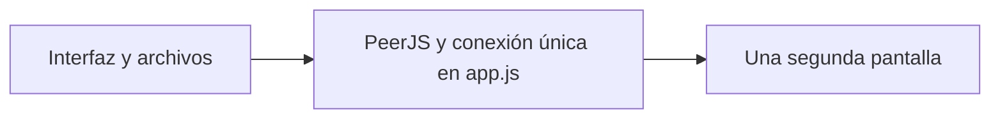
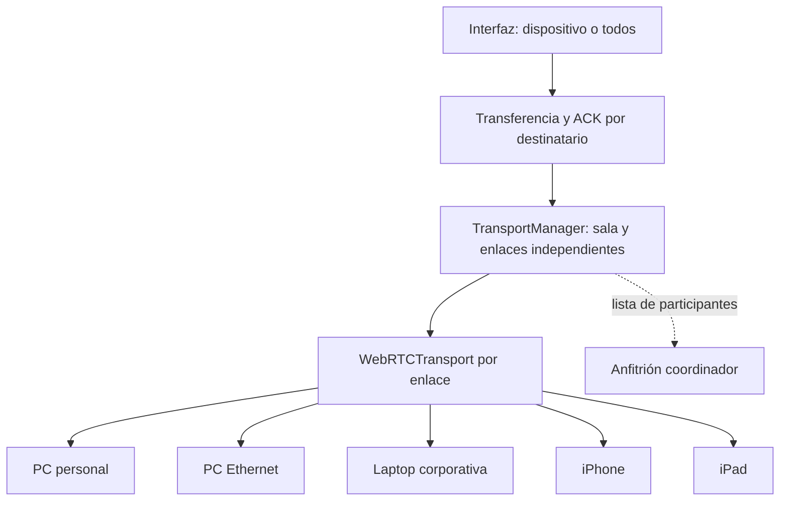

# Drop: salas compartidas y transporte · fase 1

## Auditoría del punto de partida

La versión 1.8 mantenía `peer`, `connection`, `incoming`, nombre remoto,
temporizadores y latidos como variables únicas de `app.js`. El anfitrión
rechazaba cualquier tercera conexión. El protocolo de texto, ofertas, bloques y
SHA-256 ya era reutilizable; sus ACK solo se identificaban por transferencia,
algo suficiente para dos pantallas pero inseguro al mezclar destinatarios.
Los reintentos del invitado destruían su Peer completo. Había servidores TURN
públicos antiguos incrustados y esperas de conexión de 30 segundos.

## Arquitectura implementada

Hasta ocho participantes, incluido el anfitrión. El anfitrión distribuye una
lista acotada de miembros; entre clientes actualizados se crea una malla de
enlaces. Solo un extremo inicia cada conexión para evitar duplicarla. La lista
solo se acepta desde el anfitrión y las conexiones entre invitados deben
pertenecer a esa lista y presentar el identificador efímero de la sala.
El código corto sigue siendo la autorización para entrar: no autentica personas.
Comparte el código/QR solo con los dispositivos que quieras admitir.

El contenido de un envío entre invitados no pasa por el anfitrión. No se escanea
la LAN: WebRTC aprovecha sus candidatos locales cuando existe una ruta permitida.
Los dispositivos presentes sin enlace disponible aparecen como conectando y no
pueden seleccionarse individualmente para enviar.

## Interfaz de transporte

`WebRTCTransport(connection, callbacks)` adapta un DataConnection de PeerJS:

- `send(message)`, `close(reason)`, `open`, `diagnostics()`.
- Callbacks `onOpen`, `onMessage`, `onClose` y `onState`.
- No conoce HTML, archivos, bloques ni decisiones sobre destinatarios.

`TransportManager` expone:

- `connect({host, code, device, kind, deviceType})`.
- `send(message, peerId)`; los ArrayBuffer usan la misma operación.
- `on('message', ({peerId, message}) => ...)`.
- `on('state', callback)`, `resume()`, `close(notify)` y `diagnostics()`.
- Eventos de conexión, desconexión, sala, vencimiento y aviso.

El motor de transferencia mantiene el protocolo existente. Cada espera se indexa
por **peerId + clave de ACK**; cada receptor por **peerId + transferId**.
Confirmaciones de otro dispositivo no liberan la espera. Las recepciones
completadas recuerdan solo identificadores y metadatos durante diez minutos,
con máximo de 512 entradas; los reintentos no agregan otra tarjeta. No se guarda
contenido remoto. Los archivos pendientes conservan los destinatarios ya
confirmados para no reenviarlos después de un fallo parcial.

## Estrategia de conexión y fallback

Orden objetivo: señalización HTTPS/WSS → WebRTC directo → TURN configurado y
operativo → relay WSS configurado → explicación útil del fallo.

La fase 1 instala **WebRTC**, no un servidor relay. Sin TURN configurado usa
solo STUN; no intenta servidores de respaldo inventados. Si se añaden TURN
propios, WebRTC negocia los candidatos mediante ICE, sin botones técnicos.
La elección de intentos separados directo/TURN y la migración a WSS pertenecen
a la fase 2. `relayUrl` está reservado y por sí solo **no habilita** un relay.
El diagnóstico distingue esta ausencia. No se promete atravesar VLAN, VPN o
políticas corporativas que impidan todos los transportes disponibles.

Configuración central en `transport-config.js`: señalización por 443, STUN,
TURN opcionales, ocho participantes, espera de señalización de ocho segundos y
de canal de doce. Un canal que funciona no se reemplaza por perder el broker.
Los canales caídos se recuperan por separado. Una sala vacía vence a los diez
minutos; los archivos recibidos siguen únicamente en la memoria de su pantalla.

## Archivos y migración incremental

Nuevos: `transport-config.js`, `webrtc-transport.js`, `transport-manager.js`, este
documento y pruebas del administrador. Cambios: integración en `app.js`, selector
y lista en `index.html`, estilos mínimos, build, versión/caché PWA y pruebas.
Se conservan módulos de archivos, QR, portapapeles, sesión local y protocolo.

1. Extraer transporte y configuración sin cambiar el protocolo binario.
2. Introducir membresía y enlaces independientes y el selector explícito.
3. Verificar pares antiguos, cinco participantes y aislamiento de fallos.
4. Publicar fase 1 y comprobar redes/dispositivos reales.
5. Implementar por separado RelayTransport y servidor relay acotado: RAM, TTL,
   ACK, limpieza, rate limits, límites de payload y ausencia de logs de contenido.
6. Integrar selección/migración automática y pruebas de fallback e interrupción.

Para la fase 2, el servidor puede vivir detrás de un proxy HTTPS en Linux o de
IIS con WebSocket y certificado corporativo en Windows. DNS, autorización de TI,
certificados y alcance de red deben definirse antes del despliegue. No se elige
un proveedor ni se añade un servicio externo en esta fase. E2EE de aplicación
deberá usar un diseño estándar revisado; HTTPS/WSS por sí solo no oculta el
contenido al operador de un futuro relay.

## Compatibilidad y límites

- Un cliente anterior conserva el handshake y protocolo de dos pantallas. Con
  anfitrión nuevo puede hablar con él, pero no participa en la malla. Un anfitrión
  anterior sigue admitiendo solamente un invitado. Actualizar todas las PWA para
  usar varios dispositivos; el worker cambia de versión solo dentro de `/drop/`.
- El anfitrión debe permanecer abierto para admitir miembros y distribuir sus
  cambios. Si desaparece, los enlaces ya establecidos entre invitados pueden
  continuar, pero no hay elección automática de otro anfitrión.
- Ocho equipos implican hasta siete enlaces por pantalla. Los envíos a todos
  recorren destinatarios secuencialmente; el progreso nombra el equipo activo.
  Se toma la lista de conectados al pulsar Enviar. Nuevas entradas no reciben
  envíos anteriores. No hay historial sincronizado.
- Si desaparece el destinatario individual elegido, se pide elegir otro; no se
  cambia silenciosamente al siguiente. Un rechazo o fallo parcial conserva el
  texto/archivo pendiente para revisión y reenvío manual, sin reanudación por bytes.
- Se conserva una recepción de archivo a la vez por pantalla, 50 MB por archivo,
  100 MB de bandeja/selección, treinta elementos, bloques de 64 KB y SHA-256.
- iOS puede suspender Safari. No se garantiza funcionamiento en segundo plano
  ni compatibilidad de una red solo porque funcione la señalización.

## Plan de pruebas

Automáticas: cinco participantes y malla, envío privado invitado→invitado,
difusión, bytes binarios y descarga, ACK por destinatario, deduplicación,
límites, listas inválidas, salida/reconexión sin afectar a otros, F5, cierre de
anfitrión, handshake antiguo, diagnóstico sin contenido y cachés aisladas.
Los checks/build generales también deben pasar.

El test de navegador usa RTCDataChannel real por defecto. En el entorno cloud,
la política administrada de Chromium bloquea UDP de WebRTC; se usa su adaptador
explícito `DROP_TEST_TRANSPORT=memory` para validar interfaz y protocolo. Eso no
prueba conectividad WebRTC real. No cambiar esa política ni ignorar fallos.
Las pruebas de timeout/error→relay, migración a otro transporte y TTL/limpieza
del servidor se añadirán con la fase 2; no existen aún como capacidades.

Matriz manual pendiente, con los cinco equipos en una misma sala y pruebas de
texto/archivo/recuperación en cada caso:

| Red/dispositivos | Qué comprobar |
| --- | --- |
| Personal Wi-Fi ↔ personal Wi-Fi | Envío individual y a todos |
| Corporativa Wi-Fi ↔ corporativa Wi-Fi | Señalización y canal permitidos |
| Corporativa Ethernet ↔ corporativa Wi-Fi | VLAN; explicar falta de ruta |
| iPhone ↔ PC, iPad ↔ laptop | Safari, QR, descarga y regreso tras suspensión |
| Casa ↔ trabajo / hotspot | Rutas de ICE disponibles sin eludir políticas |
| Sin red, Wi-Fi→celular, sleep/resume, F5 | Misma sala y cola; bandeja temporal |
