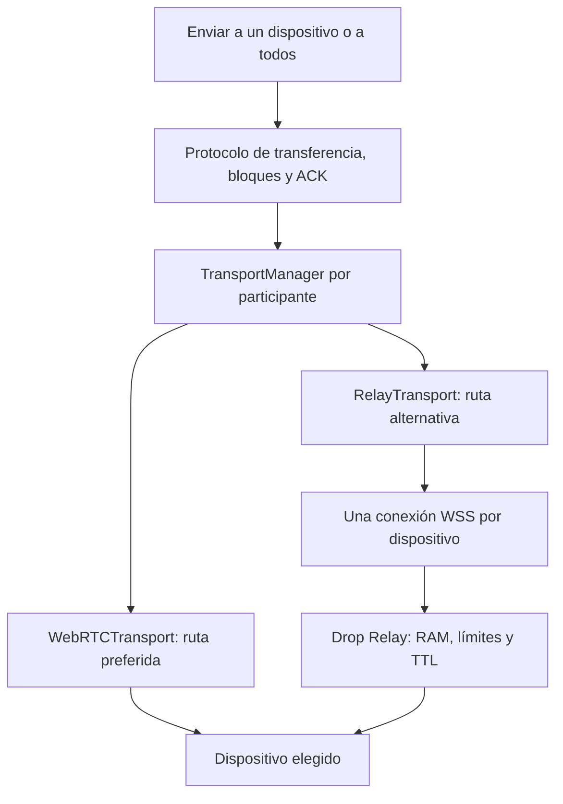

# Drop · fase 2: conexión directa y relay temporal

## Arquitectura vigente

La UI y los archivos usan el mismo protocolo de texto, oferta, bloques, fin y
confirmaciones sobre ambas rutas. Se conservan salas de cuatro números, QR,
ocho participantes, SHA-256, aceptación manual y PWA. No hay descubrimiento de
máquinas ni escaneo LAN. Los candidatos locales de WebRTC aprovechan las rutas
que permite la red.

Con relay configurado, su socket registra presencia y permite encontrar los
miembros aunque PeerJS esté bloqueado. Esa conexión de control no transporta
archivos mientras WebRTC funciona. Los enlaces se intentan de forma directa;
ICE prioriza candidatos directos y puede usar TURN propios configurados. La
negociación de ICE incluye esos TURN, no se abren dos conexiones independientes
para forzar artificialmente sus candidatos. Si el canal no abre en doce segundos,
se activa WSS automáticamente. Sin TURN configurado no se consultan servicios
públicos de respaldo. Una caída de un enlace activo prueba una recuperación corta
antes del relay; los enlaces con los otros dispositivos continúan.

Una sala del relay tiene un identificador interno de negociación adicional al
código visible; así no colisiona con una sala antigua de PeerJS con los mismos
cuatro números. Todos los dispositivos deben abrir **la misma instalación de
Drop**, preferentemente mediante el enlace/QR de su anfitrión.

## Interfaz y responsabilidades

- `WebRTCTransport`: `send`, `close`, `open`, `diagnostics` y callbacks de apertura,
  datos, cierre y estado. Encapsula PeerJS/DataChannel.
- `RelaySession`: un WebSocket para presencia y multiplexación por sala.
- `RelayTransport`: un enlace lógico con un destinatario que comparte ese socket.
- `TransportManager`: `connect`, `send(message, peerId)`, `resume`, `close`, eventos
  de estado/mensaje/migración y diagnóstico. Decide la ruta sin controles técnicos
  para el usuario.
- `relay-codec.js`: framing binario compartido por navegador y servidor. Cabecera
  JSON de hasta 8 KB; el texto UTF-8 y los bloques van como bytes, sin base64.
- `app.js`: conserva el motor único de archivos y selecciona destinatarios.
- `drop-relay/server.mjs`: HTTP de salud/UI y WebSocket acotado; no participa en el
  procesamiento de archivos ni confirma una entrega por el receptor.

## Recuperación y duplicados

Los ACK se indexan por dispositivo y transferencia. Una migración interrumpe
únicamente las esperas del enlace afectado con un estado específico; el envío
que ya estaba en curso se reintenta hasta dos veces más, con el mismo ID. Para
archivos se reinicia desde el principio y la recepción parcial se reemplaza sin
crear otra tarjeta ni reservar de nuevo su tamaño. No hay reanudación por bytes.
Las recepciones completas reconocen el mismo ID y confirman sin duplicarlo:
máximo 512 identificadores/metadatos, durante diez minutos. El emisor conserva
los destinatarios que ya confirmaron para omitirlos al reintentar un envío a todos.

El relay no guarda bloques para reenvío: las aplicaciones conservan su cola y
sus datos en memoria. Si se agotan las rutas/reintentos, el contenido pendiente
queda para revisión y reenvío manual. No existe una cola remota para entregar a
un celular o PC apagado. Ambos extremos deben estar abiertos y conectados.

Una desconexión de socket reserva la identidad durante ocho segundos para
cambios de red; salir explícitamente libera el lugar. Las credenciales efímeras
de reconexión se guardan en sessionStorage, nunca en la URL o en logs. F5 conserva
la identidad de ese navegador cuando el almacenamiento está permitido; cerrar
la pestaña o bloquear storage puede impedir recuperarla. El relay conserva los
enlaces entre invitados mientras el anfitrión se ausenta; su cierre explícito
sí cierra la sala completa. Una instalación directa sin relay sigue necesitando
al anfitrión para coordinar nuevas entradas.

## Servidor, privacidad y límites

El servidor mantiene solo miembros, claves efímeras y metadatos de transferencias
pendientes. Reenvía un bloque y lo libera; no crea archivos, base de datos,
historial, analytics, logs de contenido ni endpoints para recuperar documentos.
El ACK final elimina inmediatamente los metadatos del envío; cancelación,
desconexión o TTL también los eliminan. Los buffers de red están acotados y se
liberan al enviarse/cerrarse, sin prometer borrado físico de memoria del sistema.

- Sala: ocho dispositivos y diez minutos sin actividad real. Los pings no
  renuevan el TTL; envíos directos pueden renovar presencia sin enviar contenido.
- Archivo: 50 MB; selección/bandeja: 100 MB y treinta elementos. Texto: 512 KB;
  bloques: 64 KB. Validación de secuencia, tamaño, SHA-256 y nombres seguros.
- Relay: 256 salas y 256 sockets; 16 conexiones por IP, 30 aperturas/minuto/IP,
  128 MB y 16000 mensajes/minuto/IP. Tras proxy esas cuotas pueden compartirse.
- Hasta 16 metadatos de transferencia por sala y 100 MB declarados por receptor;
  vencen en dos minutos. Sin ACK del destinatario no se avanza el índice.
- Payload máximo: 512 KB + 8 KB + cabecera de longitud. Compresión WS desactivada;
  buffers de salida limitados y clientes lentos desconectados.
- Origen web permitido, autenticación del dueño de sala y validación del emisor
  real del socket. Un miembro no puede reenviar a otra sala ni falsificar el ACK
  de otro dispositivo. El código corto permite entrar, **no autentica personas**.

WebRTC cifra entre pares; relay usa HTTPS/WSS en producción. El operador del
relay puede técnicamente ver el contenido mientras pasa: no se implementó E2EE
de aplicación. No se deben enviar datos que la política de empresa prohíba
compartir. La app no evita restricciones corporativas. E2EE futuro requiere un
protocolo estándar revisado, no criptografía propia.

## Instalaciones y despliegue

`deployment-config.js` separa el código de la URL del servicio. GitHub Pages
conserva `relayUrl: null` hasta tener un servidor real y habilitar su origen WSS
exacto en CSP. Guardar el código o hacer push no crea infraestructura de relay.

La opción integrada despliega el mismo Drop junto al relay: el servidor entrega
ese módulo apuntando a su propio `/relay`, sin configurar URLs manualmente ni
publicar secretos. Incluye Docker y `render.yaml`. La guía está en
[drop-relay/README.md](../drop-relay/README.md). Render necesita una cuenta del
usuario; la instancia pública y sus permisos de red se verifican después del
despliegue. IIS/WebSocket con HTTPS corporativo y proxy hacia Node también es
posible, pero un servidor solo interno no será accesible desde la universidad.

## Validación

`npm run check`, `npm run build`, `node tests/drop-browser.mjs` y
`npm run check:drop:relay`. Las pruebas del servidor usan WebSockets reales:
privacidad de rutas, límites, propiedad, TTL, bytes/ACK, limpieza y origen.
La suite del navegador usa HTTP y relay WebSocket reales con cinco contextos;
comprueba archivos PDF en ambos sentidos, cambio de ruta a mitad de archivo,
señalización caída, envío a todos, F5 y reconexión. Solo los enlaces directos de
esa prueba se simulan porque el Chromium administrado bloquea UDP de WebRTC.
La suite directa conserva RTCDataChannel real por defecto y permite el adaptador
explícito `DROP_TEST_TRANSPORT=memory` cuando esa política lo impide.

La matriz física sigue pendiente: Chrome/Safari en iPhone/iPad, empresa Wi-Fi,
empresa Ethernet, universidad, casa/hotspot, cambio Wi-Fi→celular y suspensión.
Un éxito en cloud no prueba que TI permita WSS ni que iOS mantenga una pestaña
activa al bloquear la pantalla. El plan gratuito de un proveedor puede dormir;
no hay garantía de disponibilidad continua.
