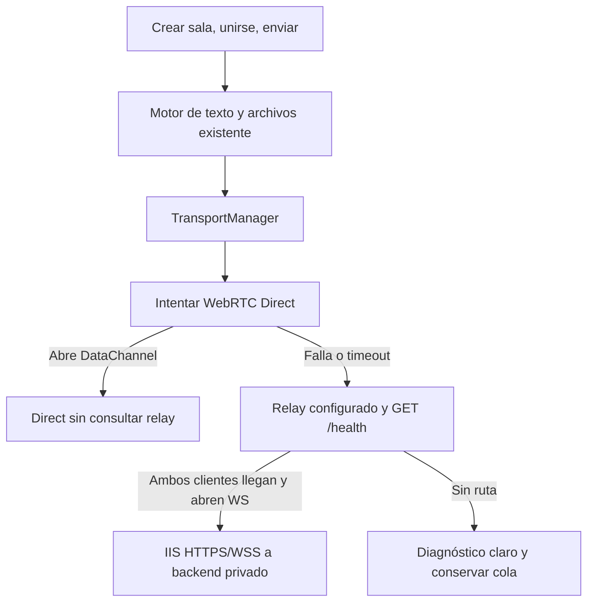

# Drop · Direct y preparación del relay privado IIS

## Estado actual

GitHub Pages conserva `deployment-config.js` con **relayUrl: null**: WebRTC y
hasta ocho dispositivos, sin consultar relay. Esta entrega no modifica UI, QR,
PWA, cola, archivos, SHA-256 ni recuperación Direct.

El frontend ya tiene WebRTCTransport, RelaySession, RelayTransport y
TransportManager. Con un relay configurado, el código anterior abre presencia
WSS **antes** de probar PeerJS. No cumple todavía el requisito nuevo de consultar
relay solo cuando falla Direct. No conectar este frontend al backend de fase 1:
la nueva selección y los archivos aún no están integrados con él.

## Arquitectura objetivo

El backend vive únicamente en el proyecto separado `reynosoch/drop-relay`, cuyo
destino debe verificarse PRIVATE antes del push. Esta fase prepara infraestructura;
no afirma que el repositorio remoto o el servidor Windows ya estén desplegados.
IIS termina TLS y hace reverse proxy a Node en loopback, como servicio Windows.
No duplica frontend ni conecta redes sin una ruta autorizada.

## Responsabilidades y contrato

- `protocol.js` y `app.js`: motor único, IDs, ACK por destinatario, nombres
  seguros, cola, progreso, SHA-256 y deduplicación de recepción.
- `webrtc-transport.js`: PeerJS/DataChannel y eventos por enlace.
- `relay-transport.js`: codec/WS y enlace lógico por destinatario; fase 2
  refactorizará su activación, sin crear otro motor de transferencias.
- `transport-manager.js`: selección y recuperación; pendiente activación diferida,
  health check y encuentro de ambos clientes tras fallo Direct.
- `transport-config.js` + `deployment-config.js`: configuración central;
  relayUrl=null continúa como valor personal predeterminado.
- `relay-codec.js`: wire v1, uint32 big-endian + JSON UTF-8 de hasta 8192 bytes
  + payload binario sin base64. Trama máxima: 532484 bytes.
- `test/fixtures/relay-wire-v1.json`: bytes genéricos compartidos con el backend
  para detectar divergencias sin copiar servidor privado al repositorio público.

Se conservan: archivo 50 MiB, bandeja 100 MiB, texto 512 KiB, bloques 64 KiB,
30 elementos. Los ACK se separan por dispositivo. El cliente conserva hasta 512
IDs completados por diez minutos; reintenta con el mismo ID sin duplicar recepción.
No hay entrega offline ni garantía con la pestaña suspendida.

## Plan por fases

1. **Servidor privado:** /health, /relay, dos miembros, TTL configurable, claves
   de reconexión, limpieza, límites, tests y manual IIS/servicio Windows.
   Reenvío básico texto/ACK para probar infraestructura; archivos deshabilitados.
2. **Frontend:** Direct primero; si funciona, cero solicitudes relay. Tras fallo,
   health acotado y WS desde cada cliente; exigir ambos presentes. Texto con el
   mismo motor. Manejar orden de llegada, fallo de señalización y fallo asimétrico.
3. **Archivos:** ofertas, chunks y ACK; metadatos limitados y limpieza tras
   ACK/timeout/desconexión; SHA-256, progreso y recovery del motor cliente.

El relay privado admite **dos**; Direct conserva **ocho**. La fase 2 debe explicar
una sala llena sin expulsar miembros ni reducir silenciosamente el modo Direct.
No agregar controles técnicos de modo para el usuario.

## Privacidad y red

Sin DB, historial, cloud storage o logs de contenido. El servidor usa RAM y
buffers limitados; reiniciarlo pierde salas. WSS protege el tránsito, pero su
operador puede leerlo: no hay E2EE adicional. Cuatro dígitos y Origin no autentican
personas; revisar identidad/acceso con IT antes de producción. Laboratorio ficticio.

Ambos clientes deben alcanzar el mismo IIS y abrir WS. localhost en iPad es el
iPad, no la laptop. Para otros equipos: DNS/ruta aprobados y certificado HTTPS
confiable. CSP y políticas de acceso a red local del navegador siguen aplicando.
Un IIS doméstico no tendrá alcance desde la universidad por instalarlo. No crear
túneles, UPnP, port forwarding, VPN ni evasión de firewall.

El servidor anterior y Render se retiraron del árbol público actual. Sus commits
ya publicados siguen en la historia pública: separar no elimina historia de Git.

## Validación

`npm run check`, `npm run build` y `node tests/drop-browser.mjs`. La suite Direct
usa RTCDataChannel real por defecto; `DROP_TEST_TRANSPORT=memory` permite su
adaptador cuando Chromium administrado bloquea UDP. Ese adaptador no valida ICE
en una red física. CI público no necesita repos privados ni secretos.

Se conservan codec/RelaySession y fixtures. Tests HTTP/WS y CI del servidor
pertenecen al proyecto privado; se retiró la integración pública que dependía
del servidor anterior y su frontend servido. Fallback y archivos nuevos se
probarán en fases 2 y 3. Pendientes: IIS real, servicio/ACL, certificados,
logout/reboot, iOS, redes físicas, cambios de red y suspensión.
